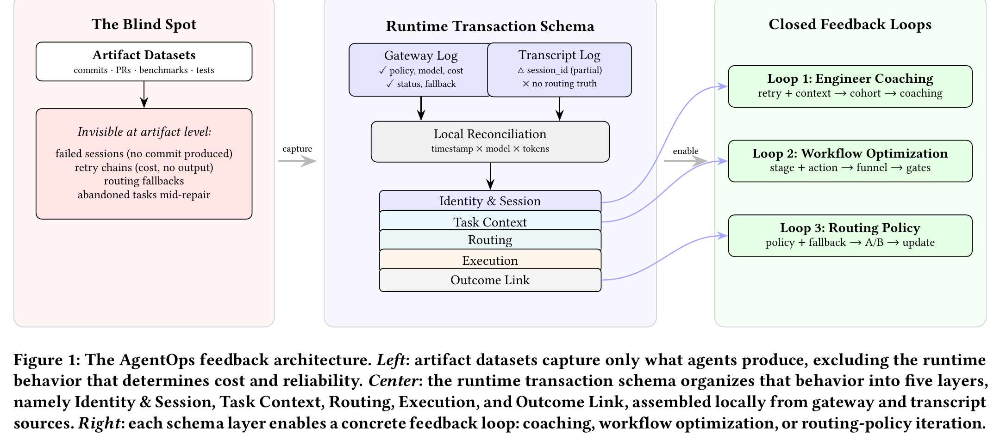

# Tracing the Messy Middle — a runtime transaction layer for AI coding agents

Reference implementation of the runtime transaction schema proposed in *Tracing the Messy
Middle: A Runtime Transaction Schema for AI Coding Agents* (Yuelin Hou, Haorui Li, Lu Chen,
Zhen Chen; arXiv:2611.23234v1 [cs.SE], 11 Aug 2026) [1].

`SPEC.md` is the normative document. `specs/schema.sql` is its executable form. `DESIGN.md`
describes the interface built on top of it.

## Abstract

Artifact datasets — commits, pull requests, passing tests — record only the work that
survived. A session in which an agent hit a rate limit, emitted a malformed tool call, fell
back to a cheaper model and gave up leaves no artifact at all: by every artifact-level
signal it did not happen, while by every cost signal it did. We implement the five-layer
runtime transaction schema of [1] and close the gaps that prevent its three feedback loops
from being computed: every observed field carries a source and a confidence instead of a
substitution, task outcome is split into an artifact class and a human verdict instead of
one mixed enumeration, and artifacts accumulate over time instead of being asserted once at
task close. The paper's nineteen-field table becomes an export projection over a
thirty-three-table PostgreSQL model in which obligations are enforced by the database rather
than by agreement. Three loops — engineer coaching, workflow optimisation, routing-policy
iteration — are realised as views over reconciled transactions. The paper's three open
problems, reconciliation accuracy, outcome linking and intervention causality, are made
measurable here, not solved: the schema records their inputs and states their confidence.

**Keywords:** AgentOps · AI coding agents · agentic software engineering · runtime
observability · record linkage

## 1. Introduction

### 1.1 The recurring failure

Three situations recur in agentic development practice, and all three are invisible to the
data the field currently collects.

*Vignette 1 — the session that never existed.* A developer's session consumes substantial
cost and produces no commit. CI, the git log and the pull-request queue are empty, so by
every artifact-level signal nothing happened. At runtime the agent hit a rate limit, emitted
a malformed tool call, fell back to a cheaper model that returned an incorrect patch, and
terminated after several failed repairs.

*Vignette 2 — the saving that costs more.* A cost-aware policy routes tasks above 8K tokens
to a cheaper provider; the per-request price drops 60 %; two weeks later total agent spend
has risen. The gateway records the resolved model and the token count, but not the retry
chains, the fallback frequency, or whether the task produced an accepted patch.

*Vignette 3 — the senior and the junior.* Two engineers use the same agent on the same class
of bug. The senior lands accepted patches in two to three requests; the junior averages nine
with three aborts. The difference is visible at runtime — broad context selection, absent
plan steps, retries that add no new information — and is visible in no artifact.

Each case has the same shape: the information needed to diagnose and repair the problem
existed at runtime and was never captured in a form that supports action. This is not a
shortage of analytics methods; funnel analysis, cohort comparison and policy A/B testing are
mature [3]. The missing piece is the data substrate.

### 1.2 Why artifacts cannot supply it

Artifact datasets do not merely undersample the behaviour they need — they structurally
cannot collect it. They are built from what agents leave behind. Sessions that terminate
without an artifact leave nothing to scrape, so the result is not a noisy measurement of
agent work but a biased sample of surviving work. Gateway logs supply routing truth but no
task context; transcripts supply session context but no routing truth; neither records
whether a session produced an accepted artifact.

The consequence is a denominator problem. Cost per accepted patch, completion rate and
fallback impact are all ratios whose denominator is the outcome link — precisely the field
absent from every source examined in [1].

### 1.3 What this repository contributes

| Contribution | Location |
|---|---|
| A normative specification that resolves every gap the paper leaves open, as 55 numbered decisions | `SPEC.md` §12 |
| An executable PostgreSQL model: 33 tables, 19 views, 1 materialised view, 18 indexes, 2 triggers | `specs/schema.sql` |
| Views that compute the three loops, including cohort floor, stage conversion and policy comparison | `specs/schema.sql` §views |
| Fixture data that reproduces the vignettes and attacks each constraint | `specs/schema_smoke.sql` |
| An interface specification for the surfaces these measurements need | `DESIGN.md` |
| Verification results on a clean `postgres:16-alpine` instance | `TEST_RESULTS.md` |

The implementation is deliberately narrower than a product: the Core API is a skeleton
(§7.5), and no claim is made that any loop improves outcomes.

## 2. Relation to prior systems

The paper surveys the systems a team could assemble today and finds that each covers one
layer of five. The comparison below restates its Table 1 evidence in the terms this
implementation uses; ✓ means recorded by default, △ partially recoverable, × absent.

| Source | Routing truth | Session identity | Task context | Behaviour (stage, action) | Outcome link |
|---|---|---|---|---|---|
| Artifact datasets (commits, PRs, benchmarks) | × | × | × | × | ✓ (surviving work only) |
| Gateway logs (LiteLLM, Helicone, Portkey) | ✓ | △ | × | × | × |
| Transcript logs (agent-local JSONL) | × | ✓ | △ | △ | × |
| Prompt/span tracing (LangSmith, Langfuse, Phoenix, OTel GenAI) [4, 5] | △ | △ | × | △ | × |
| **This schema** | ✓ | ✓ | ✓ | ✓ | ✓ (with confidence and state) |

Prompt and span tracing assume that prompt content may be forwarded to a central collector.
For coding agents that assumption fails: payloads contain private source trees, credentials
and unreleased features. The paper's deployment makes the same point quantitatively — of
6,775 transcript-side requests, the gateway observed 91, so 98.7 % of traffic ran under
subscription authentication and produced no gateway record at all. A single-source system
does not average these viewpoints; it silently adopts one.

## 3. Design

### 3.1 The five-stage loop

Improvement requires five stages, and removing any one degrades the system to either a log
sink or a dashboard. All five are represented here.

1. **Agent execution** — coding agents run on developer machines, producing gateway traffic
   and local transcripts.
2. **Runtime transactions** — a local-first layer reconciles both sources into per-request
   records linked to session and task context.
3. **Behavioural analytics** — records aggregate into funnels, cohorts, policy comparisons
   and cost attribution.
4. **Intervention** — diagnosis drives coaching, workflow templates, routing changes or
   guardrails.
5. **Measured improvement** — post-intervention transactions are compared against a baseline.

Stage 5 is the one usually missing in implementations, so it is materialised: `interventions`
and `intervention_effects` store the estimate together with its `causality_level`
(`association` or `causal`), control value, sample sizes and confidence interval. A
before/after comparison is not permitted to present itself as causal evidence.

### 3.2 Five layers, three loops



**Figure 1.** *The AgentOps feedback architecture*, reproduced from [1, Fig. 1]. Left:
artifact datasets capture only what agents produce, excluding the runtime behaviour that
determines cost and reliability. Center: the runtime transaction schema organises that
behaviour into five layers — Identity & Session, Task Context, Routing, Execution, Outcome
Link — assembled locally from gateway and transcript sources. Right: each layer enables a
concrete feedback loop: coaching, workflow optimisation, routing-policy iteration.

The unit of analysis is the task, not the span and not the request. Outcome linkage and cost
attribution require a record that crosses many LLM calls, which is why `task_id` is present
in the Execution layer rather than in a reporting join.

| Loop | Question | Views |
|---|---|---|
| 1. Engineer coaching | Where does this developer differ from peers on the same task type? | `developer_cohorts`, `developer_peer_baseline` |
| 2. Workflow optimisation | At which stage do tasks die? | `stage_funnel`, `stage_conversion`, `turn_paths`, `futile_retries` |
| 3. Routing policy | Did the task get cheaper, not the request? | `policy_comparison`, `fallback_rate_by_policy` |

Two design choices make the loops computable rather than illustrative. First, every view
that reports a per-developer aggregate joins `developer_cohorts`, so the `min_cohort_size`
floor applies inside the query instead of in the presentation layer; an aggregate that would
resolve to an individual returns no rows. Second, `fallback_rate` has an explicit
denominator: `policy_fallback_context` stores the configured chain and the prefix at each
step, because a fallback frequency without "how many switches were possible" is undefined.

### 3.3 Where this implementation departs from [1]

The paper specifies what to capture; it does not specify what to do when the sources
disagree, when a value is missing, or when an artifact appears after the task is closed.
Those cases are decided here, and each decision is recorded with its reason in `SPEC.md`.
The consequential ones:

| Gap in the logical schema | Decision |
|---|---|
| `resolved_model` undefined when no provider response arrived | `null` with `resolved_model_source = 'none'`; substituting the requested model would turn "no data" into "no substitution" and erase the effect the Routing layer exists to expose |
| `requested_model` conflated with a policy alias | `requested_model` is the physical model sent to the provider; the alias lives in `virtual_model`; `model_divergence` fires only when two response-side observations disagree |
| `fallback_chain` ambiguous between observed and configured | the projection carries `observed_fallback_chain`; the configured chain is a separate denominator in `policy_fallback_context` |
| `retry_index` undefined | `attempt_ordinal - 1` within a retry family, where a family is a sequence of attempts at the same action — not a transport retry |
| `auth_mode` mixing credentials and billing | three independent axes: `auth_mode`, `billing_mode`, `provider_kind`; `billing_mode` is never inferred from `auth_mode` |
| `outcome_type` mixing artifact class, human verdict and abandonment | two axes: `artifact_class` × `human_verdict`; `abandoned` becomes `linkage_state = 'timed_out'`, a timeout rather than a human decision |
| `outcome_link` treated as one value | a many-to-many relation with states and canonical refs (§4.3) |
| `cost_usd` mixing metered and subscription money | `cost_usd_metered` and `cost_usd_notional`, never summed |
| `R*` — required at task close — left as a convention | a deferred constraint trigger; a task cannot be closed without a current outcome row |
| Session identity assumed unique across tools | `sessions.runtime_name` plus a partial unique index: one active task per session, one session may touch many tasks |

## 4. The schema

### 4.1 Physical organisation

Reconciliation produces derived rows; raw input is never overwritten, so a normaliser can be
replayed without losing evidence.

```
agent → adapter → buffer → POST /events → raw_events → normalizer → transactions / actions / turns
                                                              ↓
                                            linker → artifacts → outcomes
                                                              ↓
                                                   views (metrics)
```

| Layer | Tables | Enforced by |
|---|---|---|
| Identity & session | `developers`, `developer_consents`, `sessions`, `session_branches`, `adapters`, `adapter_instances` | unique active task per session |
| Task context | `tasks`, `task_sessions`, `projects`, `task_type_coverage` | outcome required at close |
| Routing | `policies`, `policy_assignments`, `experiments`, `policy_fallback_context` | policy pinned per attempt |
| Execution | `raw_events`, `runtime_transactions`, `turns`, `actions`, `attempt_context`, `runs` | status rollup check, immutability of superseded rows |
| Outcome | `artifacts`, `task_artifacts`, `task_outcomes`, `artifact_class_rank` | single primary artifact |
| Governance | `settings`, `classifier_versions`, `classifier_mappings`, `metric_definitions`, `retention_policies`, `redaction_rules`, `integration_sources` | cohort floor, retention |

Derived rows carry their generator's version — `normalizer_version`, `linker_version`,
`taxonomy_version`, `classifier_versions`. A classifier change must not rewrite history,
otherwise a before/after comparison becomes unanswerable.

### 4.2 The nineteen-field projection

The schema of [1] is the export format, not the storage limit. `transactions_19` is a view;
the underlying table is a superset, and every added field must declare how it projects.
Nineteen table rows produce twenty columns: `in/out_tokens` splits into two columns because
input and output are not comparable across policies, while `stage/action_type` stays folded
into one, because unfolding both composite rows would break the one-to-one correspondence
with Table 1.

| Table 1 field | Source | Note |
|---|---|---|
| `session_id` | `runtime_transactions.session_id` | |
| `developer_id` | `runtime_transactions.developer_id` | hash by default, mode in `settings` |
| `agent_tool` | `runtime_transactions.agent_tool` | enumerated in `SPEC.md` §9.1: `pi`, `claude_code`, `codex`, `cursor` |
| `task_id` | `runtime_transactions.task_id` | |
| `task_type` | `tasks.task_type` | nullable; `unset` is a recorded state, not a silent default |
| `project` | `tasks.project_id` | |
| `auth_mode` | `runtime_transactions.auth_mode` | credential axis only |
| `policy_id` | `runtime_transactions.policy_id` | pinned per attempt |
| `requested_model` | `runtime_transactions.requested_model` | request-side fact |
| `resolved_model` | `runtime_transactions.resolved_model` | response-side fact, `null` when absent |
| `fallback_chain` | `runtime_transactions.observed_fallback_chain` | observed switches only |
| `request_ts` | `runtime_transactions.request_ts` | record created at request start, not at response |
| `in/out_tokens` | `input_tokens` / `output_tokens` | |
| `status` | `runtime_transactions.status` | `null` for a request still in flight |
| `retry_index` | `attempt_ordinal - 1` | within a retry family |
| `stage/action_type` | `stage \|\| '/' \|\| action_type` | |
| `cost_usd` | `runtime_transactions.cost_usd` | split by billing mode in aggregates |
| `outcome_link` | `task_artifact_summary.primary_ref` | best confirmed artifact |
| `outcome_type` | `task_outcome_resolved.artifact_class` | from artifacts when they exist |

Columns absent from the projection are not lost: they remain in `runtime_transactions` and in
the related tables, available to analytical queries but not to the v1-compatible export.

### 4.3 Several artifacts per task

A task acquires artifacts over time, and this is the normal mode rather than an exception: a
`file_set` at session end, one or more `commit`s hours later, a `ci_run` after a commit, a
`pull_request` and its merge days later. Treating `outcome_link` as a single value asserted
at close discards exactly the history that shows whether the task actually landed.

The relation is many-to-many and each link has a state.

| State | Meaning |
|---|---|
| `candidate` | a trace that requires confirmation, e.g. a file list from the agent |
| `confirmed` | counted towards the task's artifact class |
| `superseded` | replaced by a stronger artifact, referenced by `superseded_by_artifact_id` |
| `rejected` | a false match, kept with its reason |

The task's class is the maximum over confirmed artifacts under a fixed rank —
`merged_pr` 6, `committed_patch` 5, `multi_session` 4, `passing_unreviewed` 3,
`partial_artifact` 2, `none` 0 — and each artifact receives its class from the linker at
link time. The human's class in `task_outcomes` remains the decision taken at close;
`task_outcome_resolved.class_source` states which of the two produced the reported value
(`artifacts` or `decision`). Without this the class would freeze at close, and a pull request
merged two days later would never reach the cost-per-completed-task denominator.

References are canonical and derived from artifact fields rather than stored as free text:
`<repo>@<sha>` for a commit, `<repo>#pr-<n>` for a pull request, `ci:<run>` for a CI run,
`files:<n>` for a file set. The projection carries one reference, as the field's type
requires; `transactions_outcome_links.outcome_links` carries the array, and superseded links
stay visible in `task_artifact_summary.all_artifact_refs` without inflating the active list.

### 4.4 Invariants held by the database

Obligations expressed in prose are forgotten under deadline. These are executable.

| Invariant | Mechanism |
|---|---|
| A closed task has an outcome | deferred constraint trigger `tasks_require_outcome` |
| A superseded transaction is immutable | trigger `runtime_transactions_superseded_immutable` |
| A status rollup cannot claim success and timeout at once | check constraint over `status`, `status_detail`, `status_phase` |
| One primary artifact per task | partial unique index `task_artifacts_one_primary` |
| A session binds one active task at a time | partial unique index `task_sessions_active_per_session` |
| A developer aggregate never resolves to an individual | `min_cohort_size` applied inside the cohort views |

Metric definitions live in `metric_definitions` — formula, unit, granularity, whether the cohort
floor applies — so that a reported number and its definition cannot drift apart. That join is a
convention, not a constraint, and is the one obligation in this section the database does not
enforce.

## 5. Evaluation

The evaluation is a fixture, not a deployment study: it demonstrates that the model
computes what it claims and that the constraints fire, and says nothing about whether the
loops improve outcomes — the same limitation the paper states about Atm as a design probe.

`specs/schema_smoke.sql` loads one task of each interesting shape — a run that succeeded
with fallbacks, a run rate-limited in flight, a run whose gateway and transcript disagree
about the model, a task closed before its artifact appeared — and then reads every loop view
and attacks every constraint.

| Observation | Result |
|---|---|
| `transactions_19` rows, one with `status = NULL` (in flight) | 4 |
| Model divergence between gateway and transcript | 2 distinct models for the same requests |
| `fallback_rate` by policy | 0.5 and 0.0, with configured chains as denominators |
| `stage_conversion` edit → verify / repair → review | 1.0 / 0.0 |
| `developer_peer_baseline` | delta ±0.1 against the cohort |
| `task_type_coverage.labeled_rate` | 0.83 and 1.00 |
| Artifacts on one task: 2 commits, a PR, a CI run, a file set | 5 total, 4 active, 1 superseded |
| Class resolution after the PR merges | `merged_pr` from `artifacts`, the stored decision being `committed_patch` |
| `outcome_links` array length against its declared count | 4 and 4 |
| Constraint attacks (status rollup, missing outcome, immutability, second primary) | all four raised, none silently accepted |

The suite runs on a clean `postgres:16-alpine` instance; the transcript of the last run,
with commands, versions timings and failures, is in `TEST_RESULTS.md`.

## 6. Limitations and governance

**Privacy.** Local transcripts contain source code, paths and prompts that may include
credentials. Local aggregation alone is not a safeguard: turn counts, retry rates and
per-developer cost are productivity signals open to misuse for ranking. The paper proposes
deployment defaults, and they are configuration here rather than documentation:
`developer_id_storage` (`hashed` by default, `plaintext_local` available), `capture_content`
(`metadata_only` by default, `none` and `full_local` available), the `min_cohort_size` floor,
and retention limits on raw events. A prohibition that is not expressed as a setting is
pushed into workarounds, so both v1 capabilities survive as explicit modes with safe
defaults.

**Open problems.** The paper names three. This schema does not solve them; it makes them
measurable, and records the inputs each will need.

- *Reconciliation without shared identifiers.* Probabilistic matching on timestamp, model
  and token counts [2]. The agent setting adds a twist: a transcript entry may have no
  gateway record because the agent ran under a subscription, so absence carries diagnostic
  meaning rather than signalling a failed join. False-, missed- and ambiguous-match rates are
  not measured here.
- *Outcome linking across asynchronous systems.* The linkage window, confidence, match
  features and linker version are recorded per link, and the multi-artifact model of §4.3
  handles late arrivals, but the linker itself is not evaluated.
- *Intervention causality.* `intervention_effects` stores difference-in-differences
  estimates with control values and intervals, and `causality_level` prevents an
  association from being reported as a cause; the confounding of task-mix shifts and model
  updates remains.

**Known gaps in this repository.** The Core API is not implemented (§7.5). `SET CONSTRAINTS`
works only inside a transaction, so bulk task closure has not been exercised. Peer-baseline
weights are unvalidated. `details.modifiedFiles` as a source of `file_set` has not been
checked against real agent output. The immutability trigger may conflict with retention
deletion. Each is recorded rather than papered over.

## 7. Reproducibility

### 7.1 Requirements

Go 1.27+, PostgreSQL 16+, Docker.

### 7.2 Configuration

| Variable | Purpose |
|---|---|
| `PORT` | Core API port |
| `APP_ENV` | environment name |
| `BLUEPRINT_DB_HOST` | PostgreSQL host |
| `BLUEPRINT_DB_PORT` | PostgreSQL port |
| `BLUEPRINT_DB_DATABASE` | database name |
| `BLUEPRINT_DB_USERNAME` | user |
| `BLUEPRINT_DB_PASSWORD` | password |
| `BLUEPRINT_DB_SCHEMA` | schema |

Runtime parameters live in the `settings` table, not in code: `min_cohort_size = 5`,
`linkage_window_hours = 72`, `abandonment_timeout_hours = 72`,
`reconciliation_window_seconds = 120`, `schema_version = 2.0.0`.

### 7.3 Applying and verifying the schema

```bash
psql "$DATABASE_URL" -v ON_ERROR_STOP=1 -f specs/schema.sql
```

Verification on a disposable instance — the schema must apply cleanly and every constraint
must fire:

```bash
docker run -d --name atm-schema-check -e POSTGRES_PASSWORD=x -e POSTGRES_DB=atm postgres:16-alpine
docker cp specs/schema.sql atm-schema-check:/tmp/schema.sql
docker exec atm-schema-check psql -U postgres -d atm -v ON_ERROR_STOP=1 -f /tmp/schema.sql
docker cp specs/schema_smoke.sql atm-schema-check:/tmp/smoke.sql
docker exec atm-schema-check psql -U postgres -d atm -v ON_ERROR_STOP=1 -f /tmp/smoke.sql
```

### 7.4 Build and test

```bash
make all          # build and test
make build        # binary
make test         # go test ./...
make itest        # database integration tests
make docker-run   # PostgreSQL
make docker-down  # stop PostgreSQL
```

### 7.5 Implemented endpoints

`GET /` — liveness. `GET /health` — database state.

The Core API contract of `SPEC.md` §9.2 is specified but not implemented; the server is a
skeleton. The specified surface is `POST /api/v1/events` (idempotent on `event_key`),
`POST /api/v1/tasks`, `PATCH /api/v1/tasks/{id}`, `POST /api/v1/tasks/{id}/sessions`,
`POST /api/v1/tasks/{id}/complete`, `POST /api/v1/tasks/{id}/artifacts`,
`GET /api/v1/tasks/{id}`, `GET /api/v1/sessions/{id}`, `GET /api/v1/transactions`,
`GET /api/v1/metrics/{name}`, plus the retained v1 paths `POST /api/v1/sessions`.

### 7.6 Troubleshooting

| Symptom | Cause | Action |
|---|---|---|
| `db down` in `/health` | PostgreSQL unreachable | `make docker-run`; check `BLUEPRINT_DB_*` |
| task does not reach `completed` | linkage window still open | wait `linkage_window_hours`, or link the artifact explicitly |
| cost is zero in metrics | all traffic is subscription-authenticated | read `cost_usd_notional`, not `cost_usd_metered` |
| funnel is empty | the agent did not declare `semantic_action` | check `adapters.capabilities` |
| cohort view returns nothing | fewer than `min_cohort_size` tasks | governance floor, not an error |

## References

[1] Yuelin Hou, Haorui Li, Lu Chen, and Zhen Chen. 2026. *Tracing the Messy Middle: A
Runtime Transaction Schema for AI Coding Agents.* arXiv:2611.23234v1 [cs.SE], 11 August
2026. QingCheng.AI; Duke University; Fudan University; University of Science and Technology
of China.

[2] Ivan P. Fellegi and Alan B. Sunter. 1969. A Theory for Record Linkage. *Journal of the
American Statistical Association* 64, 328 (1969), 1183–1210. doi:10.2307/2286061

[3] Ron Kohavi, Alex Deng, Brian Frasca, Toby Walker, Ya Xu, and Nils Pohlmann. 2013. Online
Controlled Experiments at Large Scale. In *Proceedings of the 19th ACM SIGKDD International
Conference on Knowledge Discovery and Data Mining (KDD '13)*, 1168–1176.
doi:10.1145/2487575.2488217

[4] OpenTelemetry Authors. 2026. *Semantic Conventions for Generative AI Systems.*
https://github.com/open-telemetry/semantic-conventions-genai

[5] Langfuse. 2026. *Langfuse: Open Source LLM Engineering Platform.*
https://github.com/langfuse/langfuse
